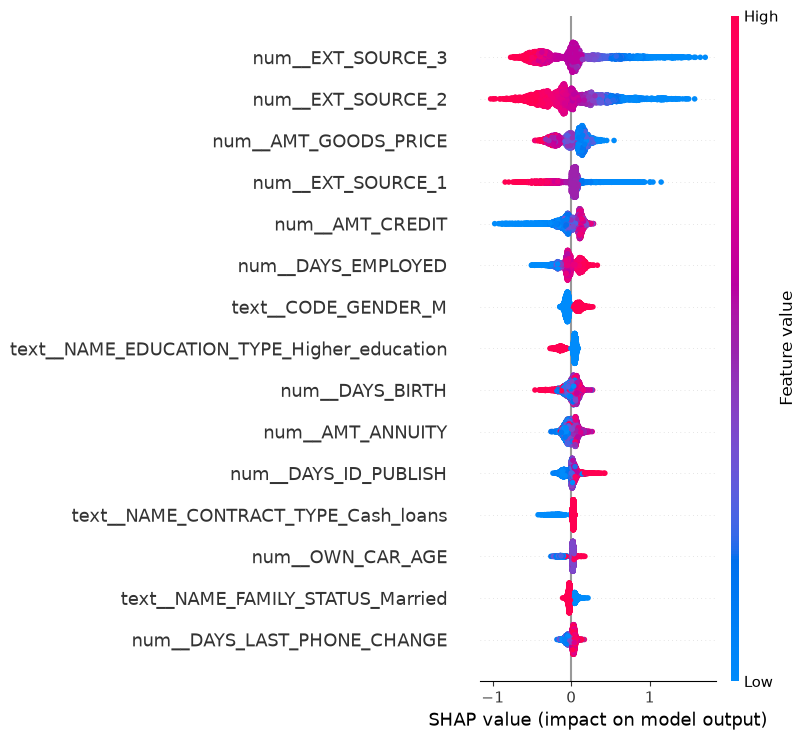

# Credit Default Risk Prediction

Predicting loan default for 307,511 applicants using the
[Home Credit Default Risk](https://www.kaggle.com/c/home-credit-default-risk)
dataset. Built as a portfolio project targeting data science internships
in finance and banking.

---

## Results

| Model | CV ROC-AUC | CV PR-AUC |
|---|---|---|
| Logistic regression | 0.747 | 0.226 |
| LightGBM | 0.755 | 0.238 |
| Random forest (val only) | 0.742 | 0.223 |

**Test set (evaluated once at the end):**

| Metric | Value |
|---|---|
| ROC-AUC | 0.760 |
| PR-AUC | 0.241 |
| Precision at threshold 0.15 | 0.242 |
| Recall at threshold 0.15 | 0.415 |
| Cost reduction vs approving everyone | 15.47% |

Random-guesser baselines: ROC-AUC 0.5, PR-AUC 0.081 (the default rate).

---


## Project structure

- `src/eda.py` — Day 1 exploration
- `src/preprocessing.py` — Cleaning, split, pipeline
- `src/train_baseline.py` — Logistic regression
- `src/train_gbm.py` — LightGBM
- `src/train_rf.py` — Random forest
- `src/cross_validate.py` — 5-fold CV
- `src/threshold.py` — Cost-based threshold tuning
- `src/explain.py` — SHAP feature importance
- `src/error_analysis.py` — FN vs TP comparison
- `src/evaluation_test.py` — Single test-set evaluation
- `src/exploration/` — Scratch scripts from EDA
- `reports/figures/` — Saved plots
- `data/` — Raw CSV (not in repo)

---

## Data

**Source:** Home Credit Group via Kaggle (307,511 loan applications,
122 columns, 8.07% default rate). Data is not included in this repo;
download `application_train.csv` from the competition page and place it
at `data/application_train.csv`.

---

## Key data findings

**DAYS_EMPLOYED placeholder (365,243):** 55,374 rows (18%) contain a
sentinel value meaning "not currently employed". Nearly all are
pensioners (55,352), who default at 5.4% vs 8.7% for everyone else.
Replaced with `NaN` and a binary flag `DAYS_EMPLOYED_ANOM`.

**OWN_CAR_AGE missingness:** 202,924 of 202,929 missing rows belong to
applicants with no car (`FLAG_OWN_CAR = N`), confirming the value is
"not applicable" rather than "unknown".

**Missing values carry signal:** default rates differ between missing
and non-missing groups for `EXT_SOURCE_1` (8.5% vs 7.5%),
`OCCUPATION_TYPE` (6.5% vs 8.8%), and `APARTMENTS_AVG` (9.2% vs 7.0%).
However, the `OCCUPATION_TYPE` gap is largely a pensioner effect:
removing pensioners shrinks it from 2.3 to 0.75 percentage points
(confounding).

**Education default rates are ordered but unevenly spaced** (10.9% for
lower secondary down to 1.8% for academic degree), so one-hot encoding
was used instead of ordinal to avoid assuming equal spacing.

---

## Method

**Split:** 70/15/15 stratified train/validation/test (seed 42), done
before fitting anything.

**Preprocessing pipeline** (fit on training data only to prevent
leakage):
- Median imputation with missing-indicator flags for numeric columns
- StandardScaler for numeric columns
- Constant-fill ("missing") plus one-hot encoding for 16 text columns
- 313 features after preprocessing

**Why PR-AUC alongside ROC-AUC:** with 92% non-defaulters, ROC-AUC can
look flattering because false alarms are divided by the large pool of
good customers. PR-AUC only measures performance on the rare positive
class and has a random baseline equal to the default rate (0.081).

**Models compared:** logistic regression (baseline), LightGBM, random
forest. LightGBM won all 5 cross-validation folds (mean ROC-AUC 0.755
vs 0.747, std ~0.003).

**Threshold tuning:** the default 0.5 threshold flags only 119
applicants (2% recall). Using an assumed 5:1 cost of missed default vs
false alarm, the cheapest threshold on validation is 0.15, reducing
simulated cost by 15.47% vs approving everyone. At a 10:1 ratio the
best threshold shifts to ~0.09 (cost reduction ~34%).

**Class weights:** `class_weight="balanced"` did not improve cost after
threshold re-tuning (best cost 15,721 vs 15,673), and it inflated
predicted probabilities (mean 0.396 vs the real rate of 0.081). The
unweighted model was kept because calibrated probabilities are usable
for loan pricing and expected-loss estimates.

---

## SHAP feature importance

Top features by mean absolute SHAP value:

| Feature | Importance | Direction |
|---|---|---|
| EXT_SOURCE_3 | 0.334 | High score lowers risk |
| EXT_SOURCE_2 | 0.320 | High score lowers risk |
| AMT_GOODS_PRICE | 0.148 | Higher price lowers risk |
| EXT_SOURCE_1 | 0.133 | High score lowers risk |
| AMT_CREDIT | 0.120 | Higher credit raises risk |
| DAYS_EMPLOYED | 0.096 | Longer employment lowers risk |
| CODE_GENDER_M | 0.071 | Male raises risk |

External credit scores dominate by a wide margin. `CODE_GENDER_M`
appearing in the top 10 is noted: a production model would likely need
gender removed and the model re-evaluated for regulatory compliance.



---

## Error analysis

Comparing false negatives (missed defaulters) with true positives
(caught defaulters):

- **External scores:** FN group averages `EXT_SOURCE_2` = 0.49 and
  `EXT_SOURCE_3` = 0.48, vs 0.30 and 0.26 for the TP group. Missed
  defaulters looked like low-risk applicants by the model's most
  important features.
- **Income type:** pensioners are 16.8% of missed defaulters but 6.2%
  of caught ones, consistent with their lower overall default rate.
- **Education:** higher-education applicants are 21.3% of missed
  defaulters but 10.3% of caught ones.
- **Contract type:** revolving loans are overrepresented in misses
  (9.8% vs 3.5%).

The model struggles most with applicants who look low-risk by external
scores but default anyway. Additional data sources (payment history,
bureau records) would likely help.

---

## Limitations

- Only `application_train.csv` was used. The full competition includes
  bureau and payment-history tables that contain stronger signals.
- The 5:1 cost ratio is an assumption. A real bank would estimate it
  from actual loan losses and profit margins.
- Calibration was not formally measured, only inferred from the mean
  predicted probability (~0.08 for the unweighted model).
- The academic-degree group has only 164 rows, so its 1.8% default rate
  is imprecise.

---

## Reproducing the results

```bash
# 1. Clone and install
git clone <your-repo-url>
cd credit-risk-model
python3 -m venv venv
source venv/bin/activate
pip install -r requirements.txt

# 2. On Mac, install OpenMP for LightGBM and XGBoost
brew install libomp

# 3. Download data
# Join the competition at kaggle.com/c/home-credit-default-risk
# Place application_train.csv at data/application_train.csv

# 4. Run in order
python src/eda.py
python src/train_baseline.py
python src/train_gbm.py
python src/train_rf.py
python src/cross_validate.py
python src/threshold.py
python src/explain.py
python src/error_analysis.py
python src/evaluation_test.py
```

---

## Stack

Python 3.13, pandas 3.1, scikit-learn 1.9, LightGBM 4.7, SHAP 0.54,
matplotlib 3.11